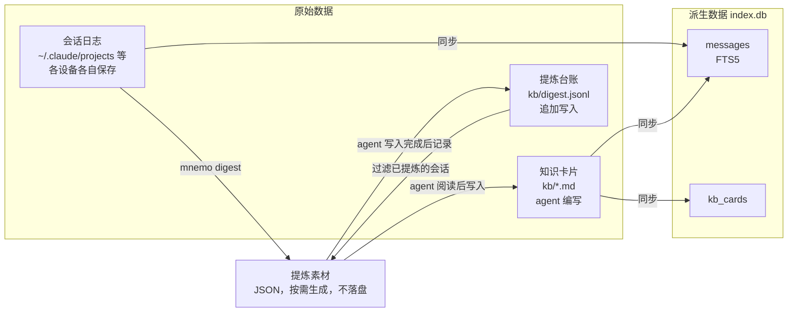
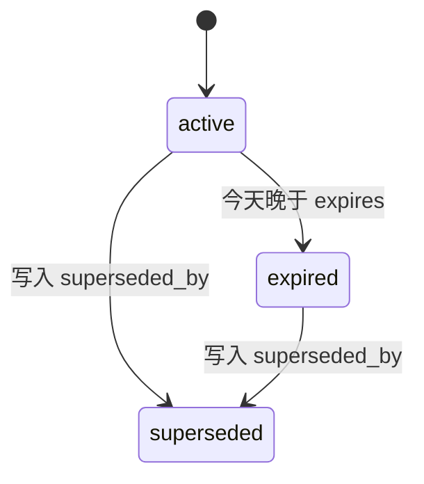

# 知识库数据结构

## 数据分层

知识库新增三类数据。其中两类保存在知识库目录里，是不可再生的原始数据；另一类是索引里的派生数据，可以随时从文件重建。`index.db` 仍然只存派生数据，`mnemo upgrade` 重建索引时不会丢失任何知识库内容。



| 数据 | 位置 | 谁写 | 能否重建 |
|---|---|---|---|
| 知识卡片 | `$MNEMO_KB_DIR`，默认 `~/.mnemo/kb/<id>.md` | agent，用户可以手改 | 不能，是原始数据 |
| 提炼台账 | `$MNEMO_KB_DIR/digest.jsonl` | `mnemo digest done` | 不能，是原始数据 |
| `kb_cards` 和 `messages` 中 `source=kb` 的行 | `~/.mnemo/index.db` | 同步过程 | 能，从卡片文件重建 |
| 提炼素材 | 不落盘 | `mnemo digest show` | 每次从索引现算 |

- 知识库目录可以放进 git 仓库或 Obsidian vault。mnemo 只读写卡片文件和 `digest.jsonl`，不管理这个目录的版本。
- 卡片由 agent 编写，内容已经过总结，不是原始会话。所以设备 A 上的卡片可以引用设备 B 的会话，这不违反“会话内容留在所在设备”的约束。
- 知识库由开关控制，默认关闭：环境变量 `MNEMO_KB=on|off` 优先，其次是 `mnemo node --kb on|off` 写入 `node.json` 的值。关闭时 `kb` source 不列出任何卡片，下次同步把已索引的卡片移出索引，默认搜索也不包含 `knowledge`。
- 一台设备只有一个知识库目录，平时由主力机上的 agent 负责提炼。其他设备通过现有的 SSH 扇出搜索看到这些卡片，知识库不需要单独同步。

## 知识卡片

每条知识一个 Markdown 文件，由头部字段和正文组成。

- 文件名去掉 `.md` 就是卡片 id，只用小写 ASCII 字母、数字和 `-`，比如 `icloud-nas-sha256-before-delete`。
- 正文第一行必须是一级标题，作为卡片标题。

```markdown
---
type: howto
scope:
- global
sources:
- claude@laptop:/Users/alex/.claude/projects/-Users-alex/3f6a2c1e-8b47-4d2a-9c15-7e0b5a9d4f21.jsonl#342
- claude@laptop:/Users/alex/.claude/projects/-Users-alex/3f6a2c1e-8b47-4d2a-9c15-7e0b5a9d4f21.jsonl#459
created: 2026-11-26
verified: 2026-11-26
---
# 删除 iCloud 文件前，用 SHA-256 核对 NAS 副本

1. `brctl download` 把仅在云端的文件下载到本地，等文件的 `dataless` 标记消失。
2. 对 iCloud 原文件、NAS 副本、导入清单三者分别算 SHA-256，三个值全部一致才继续。
3. 用 Finder 删除（`osascript … delete`），文件进入“最近删除”，30 天内可以恢复。
```

### 头部字段

| 字段 | 是否必填 | 取值 | 含义 |
|---|---|---|---|
| `type` | 必填 | `fact` `howto` `gotcha` `decision` `preference` | 卡片类型，见下表 |
| `scope` | 必填 | 列表，元素为 `global`、`host:<设备名>`、`cwd:<绝对路径>` | 这条知识在哪里成立 |
| `sources` | 必填，至少一项 | 列表，元素为来源引用 | 卡片依据的会话消息 |
| `created` | 必填 | `YYYY-MM-DD` | 第一次写入的日期 |
| `verified` | 必填 | `YYYY-MM-DD` | 最近一次证实这条知识的会话轮次的日期，只往后推，与提炼发生在哪天无关 |
| `expires` | 可选 | `YYYY-MM-DD` | 到期后知识自然失效，只用于有时效的事实 |
| `superseded_by` | 可选 | 另一张卡片的 id | 这条知识已被那张卡片取代 |

| `type` | 记录什么 | 今天会话中的例子 |
|---|---|---|
| `fact` | 环境、配置、地址等客观事实 | Mac mini 内网地址 `192.168.1.20`，Tailscale 地址 `100.64.0.7` |
| `howto` | 验证过的操作步骤 | 上面的 SHA-256 核对流程 |
| `gotcha` | 踩过的坑：现象、原因、正确做法 | 远程 shell 是 zsh，未加引号的 `$a` 不会按空格拆分（第 263 行） |
| `decision` | 做过的选择和理由 | NAS 备份按 iCloud 原路径放在 `iCloudBackup/` 下 |
| `preference` | 用户的工作偏好 | 删除任何文件前先核对备份 |

- **来源引用**的格式为 `<source>@<host>:<path>#<lineno>`，`host` 是 `node.json` 里的设备名。agent 把 `host`、`path`、`lineno` 原样传给 `get_context`，就能打开原始上下文。省略 `#<lineno>` 表示引用整个会话。
- **`scope` 用于检索过滤**。`cwd:` 前缀匹配，规则和 `search_sessions` 的 `cwd` 过滤一致；`host:` 精确匹配。一条知识对多个位置成立时，列出多个元素。
- **`verified` 和 `created` 分开记录**。agent 写卡片前先搜索已有卡片，命中就更新 `verified`、追加 `sources`，不新建卡片。来源数量和 `verified` 日期反映这条知识被证实的次数和新旧。
- **头部字段的格式**是 YAML 的严格子集，用标准库就能解析（Python 3.7 没有 YAML 和 TOML 解析器）：
  - 每行一个 `key: value`；
  - 列表字段的 key 独占一行，元素以 `- ` 开头逐行列出；
  - 不支持引号、多行字符串和嵌套。
- **不合规的卡片**照样进全文索引，但不写入 `kb_cards`，文件路径出现在搜索结果的 `coverage.warnings` 里。

### 卡片状态

状态由头部字段在读取时推算，不单独存一个字段。这样就不会出现状态字段和 `expires`、`superseded_by` 互相矛盾的情况。



- `superseded` 的卡片默认不出现在搜索结果里，传 `include_superseded` 才返回。旧卡片保留在目录里，取代它的卡片的 `sources` 可以指回旧卡片的来源，事情的前后经过不会丢失。
- `expired` 的卡片照常返回，结果里标明 `status: expired`。比如“签证材料还差银行流水，12 月 15 日前补交”这张卡片设了 `expires: 2026-12-15`，过期后 agent 能看出这是旧信息。

### 卡片的更新时机

卡片只在提炼时更新，触发更新的是新的会话。mnemo 不会主动去核实一条知识是否仍然成立。

| 触发 | 谁发现 | 卡片的变化 |
|---|---|---|
| 会话再次证实这条知识 | 提炼 agent，通过搜索或素材中的 `cards`、`related` | `sources` 追加新来源；该轮次晚于 `verified` 时，`verified` 改为该轮次的日期 |
| 晚于 `verified` 的会话表明这条知识已经不对（地址变了、决定被推翻） | 提炼 agent | 新建一张卡片，旧卡片写入 `superseded_by`；更早的会话与卡片矛盾时不改卡片 |
| 到达 `expires` | 读取时推算 | 状态变为 `expired`，内容不变 |
| 用户手改卡片文件 | 用户 | 下次同步按 `(mtime, size)` 重新索引 |

知识在现实中变了、但之后没有任何会话再提到它时，卡片会一直保持 `active`，`verified` 停在旧日期。下面三个机制缩小这个范围：

- **素材中的 `related`**：素材会列出和会话有共同关键词、作用域也覆盖这个会话的有效卡片。提炼 agent 拿它们和会话对照，有证实就追加来源，有更新的矛盾就取代旧卡片。
- **使用即验证**：后续会话里 agent 按某张卡片操作，成功或失败都会留在那个会话里。这个会话被提炼时，卡片随之被证实或被取代。
- **`mnemo kb ls --stale <天数>`**：列出超过指定天数没有被证实的有效卡片，供用户或 agent 定期复查。搜索结果也带 `verified`，读到卡片的 agent 可以按日期判断它有多旧。

## 提炼台账

`digest.jsonl` 每行记录一次提炼：哪个会话被读到了第几行，产出或更新了哪些卡片。文件只追加，不改写。同一个会话出现多条记录时，以 `upto` 最大的那条为准。

```json
{"host": "laptop", "source": "claude", "path": "/Users/alex/.claude/projects/-Users-alex/3f6a2c1e-8b47-4d2a-9c15-7e0b5a9d4f21.jsonl", "upto": 572, "ts": "2026-11-26T15:02:11Z", "cards": ["icloud-nas-sha256-before-delete", "mac-mini-addresses", "zsh-unquoted-var-no-split"]}
```

| 字段 | 含义 |
|---|---|
| `host` `source` `path` | 会话的位置，与来源引用一致 |
| `upto` | 已提炼到的最后一行 `lineno` |
| `ts` | 提炼完成的时间，UTC |
| `cards` | 这次新建或更新的卡片 id，可以为空列表 |

- **记录的是行号**，不记“已提炼过”这样的布尔值。被恢复继续使用的会话会接着增长，增长出来的部分在下一轮提炼中被选中，提炼素材从 `upto + 1` 开始。
- **`cards` 为空也要写一条记录**。没有提炼出任何内容的会话，同样要标记为已读，否则每一轮都会重新选中它。
- **台账放在知识库目录**，不放进 `index.db` 的 `meta` 表。台账是原始数据，必须和卡片一起备份，并且在重建索引后保留。
- **待提炼会话**现算得出：`files` 表中的会话，去掉台账里 `upto` 已达到该会话最大 `lineno` 的。
- **提炼会话本身不参与提炼**。提炼任务约定在知识库目录里运行，`cwd` 位于知识库目录下的会话一律排除，不需要额外的状态。

## 索引中的表示

卡片作为新的 source `kb` 接入现有的增量同步，同步逻辑不用改：`files` 表按 `(mtime, size)` 判断卡片是否变化，`file_ranges` 记录卡片在 `messages` 中的 rowid 范围。每张卡片在 `messages` 中占一行：

| `messages` 列 | 卡片的取值 |
|---|---|
| `body` / `text` | 整个文件（头部加正文）/ 标题加正文 |
| `grams` | 由 `text` 生成，与会话消息相同 |
| `source` | `kb` |
| `session_id` | 卡片 id |
| `cwd` | `scope` 中第一个 `cwd:` 的路径，没有则为空 |
| `ts` | `verified`，补齐为 `YYYY-MM-DDT00:00:00Z` |
| `role` / `kind` | `assistant` / `knowledge` |
| `path` / `lineno` | 卡片文件的绝对路径 / `1` |

头部字段另外存入 `kb_cards`，供过滤和结果展示使用。

- 这张表从卡片文件派生，卡片删除时和它的 `file_ranges` 一起删除。
- 引入它需要把 `SCHEMA_VERSION` 升到 `5`。从 v4 迁移只需建表，卡片在下次同步时作为新文件进入索引。

```sql
CREATE TABLE IF NOT EXISTS kb_cards (
  path          TEXT PRIMARY KEY,   -- 与 files.path 相同
  id            TEXT NOT NULL,
  type          TEXT NOT NULL,
  scope         TEXT NOT NULL,      -- JSON 数组
  sources       TEXT NOT NULL,      -- JSON 数组，元素为来源引用字符串
  created       TEXT NOT NULL,
  verified      TEXT NOT NULL,
  expires       TEXT,
  superseded_by TEXT
);
CREATE INDEX IF NOT EXISTS kb_cards_id ON kb_cards(id);
```

- **`DEFAULT_KINDS` 加入 `knowledge`**。`knowledge` 命中排在会话消息之前，同类之间仍按 BM25 排序；多设备结果在 RRF 合并之后再按这个规则分组。agent 先看到结论，需要细节时再沿 `sources` 回到原会话。
- 卡片命中在现有结果字段之外多一个 `card` 对象：`{id, type, status, scope, sources, verified, expires}`，其中 `status` 是读取时推算出来的。
- `cwd` 列只存 `scope` 中的第一个 `cwd:`，这是为了复用现有的 `cwd` 过滤。多个 `cwd:` 的卡片在 `kb_cards.scope` 中保留完整列表，过滤时再查这张表。
- 归档（`archive.py`）跳过 `kb` 这个 source。卡片文件本身就是原始数据，删除卡片即表示用户不再需要它，不应该从归档里把它找回来。

## 提炼素材

`mnemo digest show <path>` 从索引中为一个会话生成提炼素材，按用户消息分成轮次，每轮只保留信息最密集的部分。素材在会话所在的设备上生成，与 `get_context` 一样，只返回请求的内容。

```json
{
  "session": {"host": "laptop", "source": "codex", "path": "…/rollout-2026-11-17T01-11-56-….jsonl", "cwd": "/Users/alex", "title": "我最近装了 docker", "from": 1, "to": 584, "started_ts": "2026-11-16T17:12:11Z", "last_ts": "2026-11-25T17:04:03Z"},
  "turns": [
    {"lineno": 456, "ts": "2026-11-25T16:56:24Z", "user": "帮我看一下怎么连到我的NAS上。",
     "tools": [{"lineno": 470, "call": "exec_command(…smbutil view…)", "result": "…"}], "tools_dropped": 20,
     "answer": {"lineno": 548, "text": "找到了：你的 NAS 是 **nas-home**，地址 **192.168.1.30** …"}}
  ],
  "cards": [],
  "related": [{"id": "mac-mini-addresses", "title": "…", "type": "fact", "status": "active", "verified": "2026-11-26", "expires": null}],
  "clipped": {"tools": 101}
}
```

| 字段 | 内容 | 截断规则 |
|---|---|---|
| `session` | 会话元数据，`from`/`to` 是这份素材覆盖的行号范围 | 不截断 |
| `turns[].user` / `ts` | 一条 `role=user, kind=text` 的消息及其时间，每条开启一轮 | 500 字符 |
| `turns[].tools` | 本轮最后几次 `tool_call` 及紧随其后的 `tool_result` 开头 | 每轮最多 4 组；调用 200 字符，结果 160 字符 |
| `turns[].answer` | 本轮最后一条 assistant 文本 | 800 字符，最后一轮 2000 字符 |
| `cards` | 已经引用这个会话的卡片 id | 不截断 |
| `related` | 作用域覆盖本会话（`global`、本设备、任一方向包含的目录）且和会话有共同关键词的有效卡片，带 `summary`、`shared`、`score` | 最多 10 张，`score` 高的在前 |
| `clipped.tools` | 因每轮上限被丢掉的工具调用总数 | — |

- **按轮次组织**。一个会话常常前后处理好几件事：上例的会话依次处理了 docker、磁盘清理、截图软件和 NAS 连接。每轮保留自己的结论，前面话题的命令和答案不会被后面的挤掉。
- **每轮只留最后几次工具调用**。一轮里前面的调用多是探索和试错，最后几次通常是成功的那条命令。工具结果只取开头，用来判断成功还是报错，需要完整输出时 agent 按 `lineno` 调用 `get_context`。
- **用户消息全部保留**，不用规则去筛选“纠正”类消息。“不是……”“不用管”这类纠正要结合上下文才能判断，交给 agent 判断比在 mnemo 里写关键词规则可靠。
- **`cards` 和 `related`** 让 agent 在写卡片前先看到可能重复或可能过时的已有卡片。只按作用域列出时，同一台设备上的卡片每次全部出现，没有参考价值，所以 `related` 还要求关键词重合：
  - 卡片的关键词取自标题和不超过两个词的反引号内容（地址、路径、选项名）。正文和整条命令里的词，大部分卡片都有。
  - 每个共同关键词按它在全部卡片中的稀有程度加权（`log N/df`），标题的汉字二元组少量加分。
  - 至少两个共同关键词，且得分不低于 `1.5 log N`（两个只出现在一张卡片里的词得分的四分之三）。
  - 例：19 张卡片时，「ssh 到家里的 macmini」会话的 `related` 只剩 `tailscale-on-this-mac` 和 `mac-mini-blocked-from-foreign-sites-2026-11-25`；只按作用域时是全部 18 张同设备卡片。
- 素材不包含 `reasoning`。推理过程篇幅大，其中的结论通常已经出现在 assistant 文本里。
- 素材大小随轮次增长。上例 584 行、9 轮的会话约 17 KB；只有两三轮的会话在 5 KB 以内。

提炼流程（选会话、查重、写卡片、记台账）写在 `integrations/skills/mnemo/distill.md`，由 agent 按它执行。
